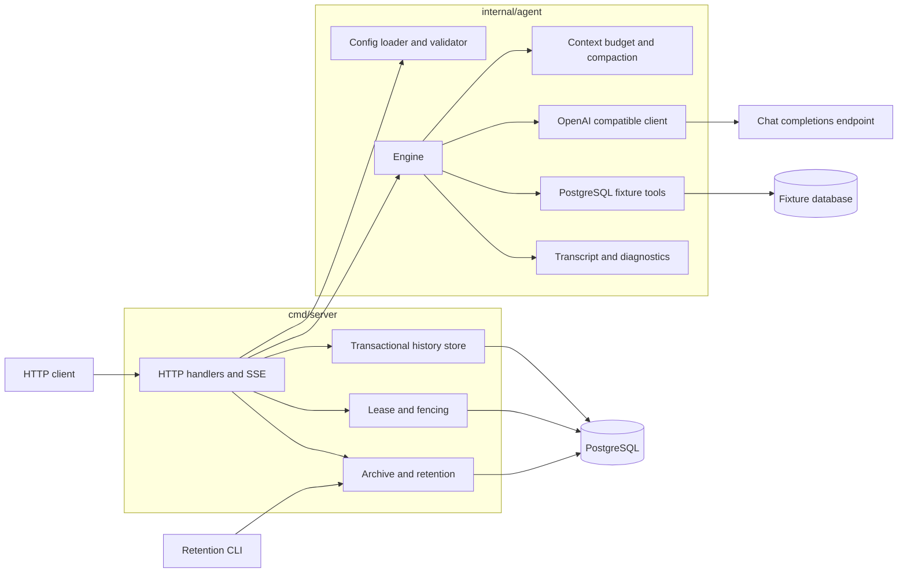
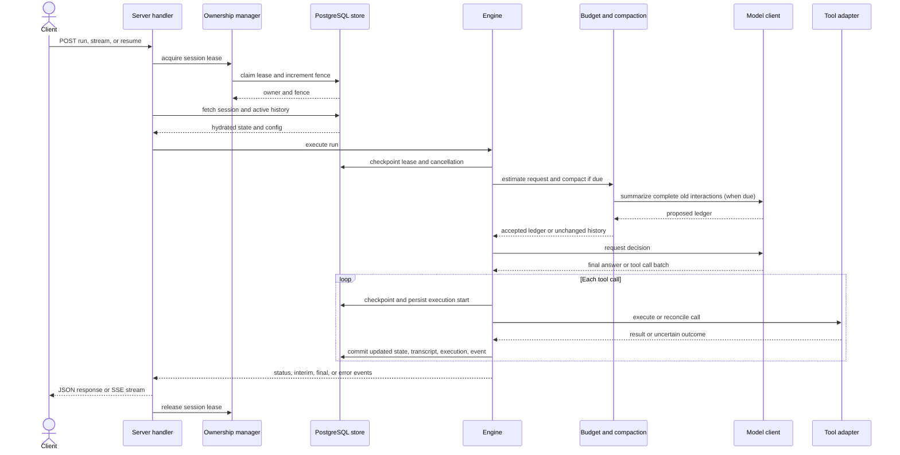
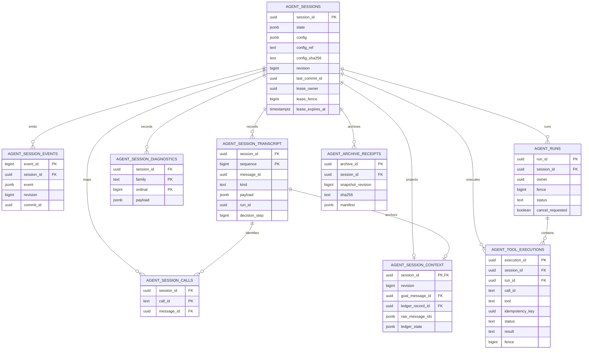

# Go architecture

The Go service is a state-driven agent runtime with a PostgreSQL-backed session store. The executable is `cmd/server`; reusable agent behavior, configuration handling, context management, and PostgreSQL fixture tools live in `internal/agent`.

## Runtime components

- **Configuration loader (`config.go`)** loads a YAML file rooted under `AGENT_CONFIG_ROOT`, expands `${NAME}` and `${NAME:-default}` expressions, applies defaults, validates the configuration, and computes hashes for both the source file and resolved configuration. A `config_ref` is a relative YAML path and symlinks may not escape the configured root.
- **Engine (`engine.go`)** owns the mutable session state and run lifecycle. It validates model decisions and tool arguments, enforces workflow tool permissions and evidence requirements, records successful evidence, checks completion requirements, bounds invalid responses and no-progress runs, and recovers pending tool calls on resume.
- **OpenAI-compatible client (`openai.go`)** converts internal messages to chat-completions requests, parses native tool calls (including multi-call turns), requests summaries, and records request diagnostics. It also estimates request size from the complete projected request.
- **Context manager (`context.go`, `engine.go`)** groups complete assistant/tool interactions, measures context pressure, and conditionally compacts older complete groups into a validated ledger. Compaction records source fingerprints, indexes, attempts, decisions, and outcomes. Failed or rejected summaries do not replace active history. Accepted compaction preserves the immutable goal, compacted ledger, and raw working buffer; it must reduce the projected request and bring it within the hard context budget.
- **Transcript and diagnostics (`transcript.go`)** assign stable message IDs, timestamps, and a shared sequence to transcript/audit records. Staged outboxes let persistence acknowledge work only after commit. Hot session state holds bounded projections and active context references; durable history is stored separately.
- **PostgreSQL history store (`cmd/server/history_store.go`)** commits the session snapshot, immutable config anchor, revision/commit fingerprint, transcript, active context, diagnostic rows, run and tool execution lifecycle, call mapping, and retention state transactionally. Fetch hydrates the active state with revision and identity checks; archived transcript and diagnostics are paged from their durable tables.
- **Ownership and recovery (`cmd/server/ownership.go`)** use database leases with monotonically increasing fences. A worker renews its lease while operating, checks ownership/cancellation at execution checkpoints, and cannot commit after losing its fence. Expired running lifecycles are reconciled at startup and can be explicitly resumed.
- **Retention (`cmd/server/retention.go`)** exports canonical JSONL archives from a read-only repeatable-read snapshot and verifies framing, table and row order, counts, watermarks, and digests. Telemetry pruning is an explicit CLI operation with archive, revision, digest, terminal-state, and ownership checks; HTTP exposes a read-only plan.

## Component diagram

This component view shows the main runtime boundaries and the durable store they share.

## Run sequence

The sequence below follows the run/stream path: ownership is acquired before state hydration, every durable update goes through the transactional store, and lease/cancellation checks guard execution boundaries.

## Persistence UML

The database stores a compact current snapshot in `agent_sessions` and keeps transcript, context, execution, and diagnostic history in related tables. The diagram omits indexes and routine timestamp/revision columns.

## Session execution

A session begins with an immutable goal and a user memory entry. At each decision boundary the engine checks its execution checkpoint, advances eligible workflow transitions, evaluates the request budget and compaction policy, then asks the model for a final answer or one or more tool calls. Calls are validated and executed in order. Each result is paired with its call in the transcript, and eligible results become workflow evidence or completion artifacts. A final answer is accepted only after configured workflow and presentation/result checks pass. Rejected decisions and finals become runtime feedback in memory; configured invalid-response and no-progress limits end the run with recoverable state.

Tool execution state distinguishes pending, started, completed, failed, and uncertain outcomes. Recovery policy is configurable per tool. Read-only tools can be retried; idempotent tools use an idempotency key; reconcilable tools can query their outcome. If a side effect may have happened and cannot be reconciled safely, the run blocks for recovery rather than repeating the call blindly. Pending calls and durable execution records support `/resume` after interruption.

The model payload includes the configured system prompt, immutable original goal, configured completion instructions, any compacted context, executed-result artifacts, the raw working buffer, argument bindings, and current workflow guidance. Workflow state and evidence remain structured session data, outside compactable conversation history.

## Persistence and HTTP boundary

The server uses `net/http` and `pgxpool`. PostgreSQL is authoritative for sessions, revisions, events, transcript, context, diagnostics, runs, executions, archive receipts, and ownership. Saves use a transaction and an idempotent commit identity so a retry can acknowledge an already committed write. Message and diagnostic outboxes are cleared only on successful acknowledgement. Config JSON and its source reference/hash are immutable session anchors.

The HTTP API serves health, config discovery, session creation/read, message append, run, stream, resume, and cancel operations, plus paged run, event, transcript, execution, archive, and diagnostic history, retention plans, and abandoned-run listing. Streaming uses SSE. `/docs` serves Swagger UI and `/openapi.json` serves the embedded OpenAPI document. The retention CLI provides explicit `plan`, `export`, `verify`, and `prune-telemetry` commands; there is no destructive retention HTTP endpoint.

The database schema is initialized at startup under an advisory lock. A schema-control marker prevents the one-time legacy schema reset from running on every restart. The current schema stores `storage_version` 6 state and separate normalized history tables.
