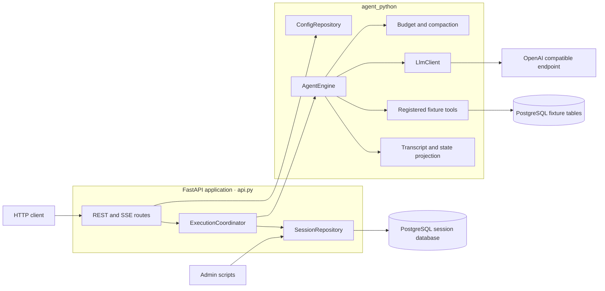
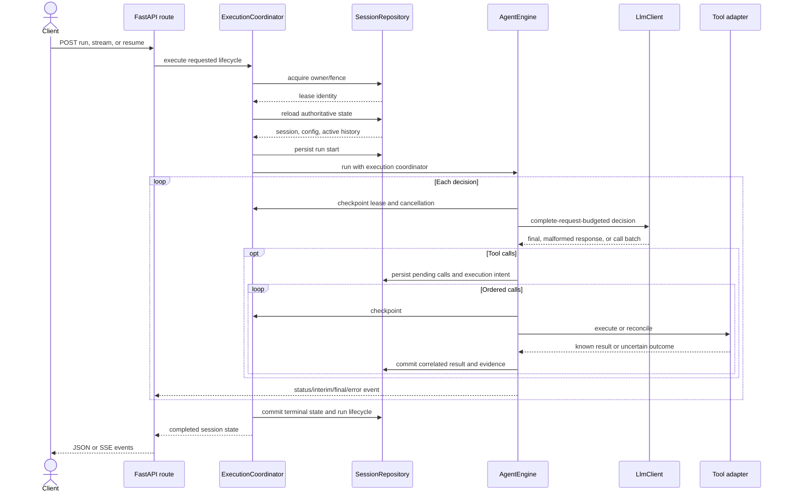
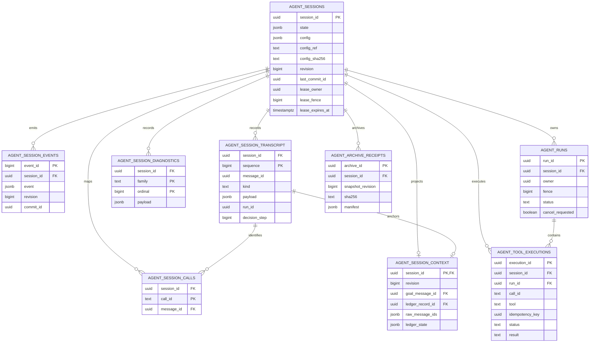

# Python architecture

Current implementation architecture, 2026-10-20. Start with the [docs index](README.md), [implementation guide](implementation.md), and [observable contract](../../contract.md).

Reference: [contract 1.1.0](../../contract.md), [frozen reference baseline 1.0.0](../../archive/agent-python-cleanup-20261016/reference/python-1.0.0/README.md). Python is the qualified behavioral reference. Go/Java/Rust still require the upgraded contract port; shared successful examples do not certify full parity.

## Components and boundaries

| Module | Responsibility |
| --- | --- |
| `config.py`, `models.py` | Trusted YAML resolution, immutable session/configuration anchors, wire/API/state types |
| `api.py` | HTTP/SSE lifecycle, authoritative reloads, coordinated startup and durable execution boundaries |
| `engine.py` | Decision loop, argument validation, workflow transitions/evidence, deliverable validation and progress policy |
| `llm.py`, `model_errors.py` | Async OpenAI-compatible HTTP, provider error classification, complete/correlated wire history |
| `context.py` | Conservative full-request budgeting, complete interaction groups, typed unverified ledgers |
| `transcript.py` | Stable message IDs/sequences and transient immutable-history outbox |
| `execution.py`, `execution_store.py` | PostgreSQL leases, heartbeat/fencing, durable run/tool intent/results and policy-aware recovery |
| `persistence.py`, `storage.py`, `storage_state.py` | Atomic revision-checked commits, selective hydration, diagnostic archives and pagination |
| `completion.py`, `validation.py` | Strict tool JSON/schema checks, result bindings and independent final format/artifact checks |
| `tools.py` | Registered async fixture tools using native Psycopg async connections; string success/error results |
| `retention.py` | Keep-all default, consistent verified export, dependency-protected telemetry-only pruning |

The application uses ordinary FastAPI, HTTPX, Psycopg and Pydantic; no agent orchestration framework. The parent curl validation guide uses the same HTTP requests and assertions for every language implementation.

### Component diagram



### Run lifecycle sequence



### Persistence UML



## Session creation and loop

`ConfigRepository` resolves a relative YAML file below `AGENT_CONFIG_ROOT` (default root `config/`), rejects traversal/absolute/non-YAML/symlink escapes, validates the configuration and tool references, and computes raw and resolved configuration hashes. Root `.env` supplies `MAIN_MODEL` with priority over an inherited model value; the user can change it freely for new sessions. There is no model pin. Resolved settings are stored with each session so later YAML/environment changes cannot silently rewrite that session.

The original goal is an immutable field and the first user message. Every message has a stable UUID, monotonically assigned per-session sequence and creation time. The model receives only role/content/tool-call fields, not persistence metadata.

The service acquires PostgreSQL execution ownership and reloads authoritative state before a bounded run. The loop advances eligible workflow edges, assesses compaction and complete-request budgets, places current missing requirements/constraints near the next action, and invokes the model asynchronously. Invalid/empty decisions receive bounded correction feedback. A valid tool batch is normalized and correlated; every call has an ordered result. Arguments and phase/tool policy are checked before invocation. Executed results update durable workflow evidence and completion artifacts; model prose cannot supply that evidence. Configured no-progress detection handles alternating rejected/redundant calls.

A final answer requires a nonempty valid response, completed configured workflow, and all configured exact/pattern/JSON/result-artifact checks. Once every workflow phase is complete, the runtime rejects every tool call before execution and directs the model to final synthesis; workflow-free agents retain their configured tool policy. Plain workflow-free completion remains supported. Run step allowance is independent of compaction cadence; exhaustion is resumable failure, not a summary trigger. The service commits final state/run lifecycle before exposing the final event. The engine alone, without an execution coordinator/repository, does not establish durable service guarantees.

## Durable ownership and execution

`agent_sessions.lease_owner` is a generated owner UUID, not a user session token or `config_sha256`. `lease_fence` increases on acquisition, and `lease_expires_at` controls expiry. Default leases last 30 seconds; the coordinator renews every 10 seconds. Database guards reject expired/stale owners and stale revisions. Local locks/cache are performance aids; PostgreSQL is authoritative. All session-ID routes validate UUID syntax before SQL (422); unknown valid UUIDs return 404.

Before a validated tool executes, the coordinator commits intent and a started-attempt marker. A returned result is committed atomically with the correlated result message, evidence and state. Recovery uses durable identities and a stable idempotency key. Read-only/repeatable adapters may retry within policy; idempotent tools need an actual idempotent adapter; uncertain outcomes requiring reconciliation block instead of being blindly replayed. Cancellation is cooperative at scheduling boundaries, preserves known results, and does not undo effects or promise external exactly-once execution.

Runs have separate durable identities/status. `/cancel`, JSON-request disconnect and SSE disconnect request cancellation. Explicit `/resume` starts a new run/fence while preserving the goal/config/transcript. Startup marks abandoned runs for explicit recovery without executing tools/models. A session-scoped PostgreSQL advisory guard spans DDL commit and recovery, preventing concurrent worker DDL/read deadlocks. Current-schema checks avoid repeated DDL. The initializer includes legacy import logic, but the dedicated fresh `universal_state` database needs no legacy-project migration.

## PostgreSQL schema 5 and hydration

See [schema.sql](../../archive/agent-python-cleanup-20261016/reference/python-1.0.0/schema.sql) for the source-derived DDL snapshot; production setup uses the runtime initializer, not a second hand-maintained DDL installer.

| Table | Contents |
| --- | --- |
| `agent_sessions` | Hot state/configuration JSONB, hashes, revision/commit identity, lease owner/fence/expiry, storage version |
| `agent_session_transcript` | Immutable ordered messages and audit/provenance records; unique sequence and message identity |
| `agent_session_context` | Current revision, goal/raw message IDs, active ledger ID and typed ledger |
| `agent_session_events` | Durable events, revision and commit identity |
| `agent_runs` | Run ownership/fence, lifecycle, cancellation and last decision step |
| `agent_tool_executions` | Tool/call identity, arguments/policy, attempts, idempotency key, outcome and timestamps |
| `agent_session_diagnostics` | Append-only diagnostic family/ordinal/payload rows |
| `agent_session_calls` | Normalized historical call lookup |
| `agent_archive_receipts` | Verified telemetry archive/dependency receipts |
| `agent_schema_migrations` | Applied component/storage versions |

Ordinary reads use one MVCC SQL statement to hydrate hot state, resolved configuration, active goal/raw messages, current ledger and recent diagnostics consistently at one revision. Historical transcript and diagnostics are explicit/paginated reads. The active prompt is not an `is_compacted=false` message-table query. Compaction does not delete or mass-flag history; it atomically replaces context references while preserving source rows/provenance.

Snapshot/context/transcript/call/diagnostic/run/tool/event changes commit together under revision CAS and lease fencing. Duplicate commit identity with identical content is handled idempotently; inconsistent duplicates, source hashes, sequences or references fail. Recent diagnostic arrays are capped at 32 per family, with lifetime counters retained outside model context. Default retention deletes nothing. Explicit export/pruning requires verified current data, terminal resolved work, dependency receipts and a fenced atomic operation; transcript/recovery records remain protected.

## Fixtures and operations

All four implementations' current fixture tools use PostgreSQL: `agent_fixture_access_logs`, `agent_fixture_customers`, `agent_fixture_orders`, and `agent_fixture_employees`. The deterministic recipe produces 650 log rows, 2200 customers, **6502 orders** and 1000 employees. The old generator console's “6500 orders” text is imprecise; the initial two orders plus 6500 generated orders are frozen explicitly. Tools do not consume the old `agent-python/data/commerce.sqlite3` or `access.log`; those are archived.

[operations.md](operations.md) covers fresh setup, run/recovery, pagination and retention administration. [test-cases.md](../../test-cases.md) is the shared curl validation guide. [compaction.md](compaction.md) is the current single compaction specification. Historical test tooling and evidence are preserved in the parent archive.

## Implementation-level data contract

A port needs four different representations, not a single mutable transcript object:

| Representation | Key fields | Mutation / persistence rule |
| --- | --- | --- |
| Configuration snapshot | raw ref/hash, canonical resolved config/hash, system/tools/workflow/policies | Materialize defaults once; deep-copy for engine ownership; do not re-read source YAML to resume |
| Active session state | immutable goal/ref; revision; task/run statuses; lifetime step/run counters; workflow/evidence; artifacts; current raw messages/ledger references; pending calls | Only the current owned revision can commit; control/progress state is outside summary claims |
| Immutable transcript entry | message UUID, per-session sequence, kind, payload, run UUID, decision step, original timestamp | Append in sequence; an identical replay is permitted, a changed identity or gap is an integrity failure |
| Transient write outboxes | transcript/diagnostic/execution/retention pending records, pending commit UUID | Stage changes until one successful transaction; clear only after acknowledgement; not model context |

A newly created engine state starts at revision 0; API creation saves revision 1. Goal is sequence 1. All message and audit-record kinds share the transcript sequence counter. `Message.wire_payload()` omits nulls and includes only role/content/name/tool_call_id/tool_calls. A transcript message payload is this wire data; UUID/sequence/timestamp live in the transcript envelope and are restored during hydration. Do not send these persistence fields to the model.

`status` describes the task (`active`, `complete`, `failed`). `run_status` describes one durable execution (`idle`, `running`, `complete`, `failed`, `cancelled`, `interrupted`, `blocked`). `step_count` is lifetime decisions; run allowance is additional decisions from the current count. `run_count` advances on continued runs. A port must not collapse these counters or statuses into one field.

## Request and execution sequence

### Create / read / append

```text
create:
  resolve trusted YAML; validate registered tools and policies
  snapshot raw/resolved identities; create goal message and transcript outbox
  commit revision 1 with creation event; return 201

read:
  validate UUID; hydrate current authoritative revision and immutable config
  verify context/message/ledger/sequence/config consistency
  reuse only a matching immutable engine configuration; return current state

append:
  acquire a PostgreSQL owner/fence; hydrate again after acquisition
  require active task with no pending tool calls
  acknowledge any abandoned lifecycle as needed; reset current run to idle
  append user message; reset progress fingerprint; fenced atomic save; release
```

The initial `_record` read is not a license to execute. `_execute_run` claims ownership and **reloads after claiming**, then replaces the coordinator's state with that owned revision. This prevents a stale pre-claim snapshot from driving work. A competing mutation gets 409; do not queue it against a stale local copy.

### Run / resume

```text
acquire owner UUID and increasing fence; start async heartbeat
hydrate owned revision
for resume:
  reactivate task; clear final/error/invalid/progress state for continuation
  require pending work to be recovered before accepting new content
commit new durable run identity/start record
append optional new-turn content under the new run; preserve original goal
recover pending tool calls according to their immutable execution policies
repeat within this run's additional decision allowance:
  checkpoint lease/cancel
  apply at most one eligible workflow edge in declaration order
  compact if needed; require complete decision request to fit
  checkpoint lease/cancel; await model response
  increment lifetime decision count; archive decision
  reject malformed/empty/action/final violations with bounded feedback, or:
    stage complete normalized call batch and persist scheduling
    execute calls sequentially with per-call checkpoints and durable boundaries
    update deterministic evidence/artifacts and correlated messages
  advance/check progress and completion according to current state
commit terminal task + run metadata before exposing terminal result
release only this owner/fence; stop heartbeat
```

A normal `/run` on an already-terminal task does not start another decision run. `/resume` is the explicit continuation operation. SSE on a terminal `/run/stream` is a 409 before streaming. Streaming ownership conflicts after headers become recoverable SSE error events. A request-level disconnect/cancellation does not authorize a second owner to write early.

### Tool result boundary

For a model batch, normalize all calls first, retain order and correlation IDs, and persist assistant-call message plus pending calls before environment invocation. For each call:

1. Validate declaration, typed JSON arguments, result-bound argument values, global tool policy and active phase. An invalid call emits a correlated error result with `executed:false`; it does not create a false successful execution/evidence record.
2. For a valid call, create a stable execution UUID/idempotency key, immutable arguments/policy, and commit `pending` intent. Commit `started` and incremented attempt count before calling the adapter.
3. Await the adapter while renewal remains schedulable. Classify explicit transient failure, known error string and uncertain outcome separately.
4. Stage known result/outcome. Append its exactly correlated tool message, update matching evidence/artifacts and consume pending call, then persist the combined state/execution/outcome transaction through the emitted persisted event.
5. If cancellation arrived during the call, allow a fenced known-result commit, then stop scheduling. Expired ownership still rejects the result commit.

`execution_pending` does not bypass repository checks. Terminal execution writes require exactly one correlated result in active memory with matching name/content and no remaining pending call of that ID. A terminal row cannot later be rewritten to a different result or decreased attempt count.

## Atomic commit protocol

`SessionRepository.save` stages messages/diagnostics, validates the resolved config anchor, retains a generated pending commit UUID, and hashes the proposed complete commit content. The transaction is:

```text
lock session row FOR UPDATE
check current owner/fence/expiry (or reject unowned mutation while leased)
if identical previous commit UUID + content hash:
  acknowledge already-committed revision; do not append duplicate records
else:
  require storage version 5 and expected revision
  require unchanged goal/raw-config reference/hash and resolved config identity
  insert or CAS-update hot snapshot/config/commit metadata at revision + 1
  write/validate transcript sequence and immutable identities
  write normalized historical call identities
  append diagnostics; write/validate runs and tool execution outbox
  insert event with revision/commit identity
  write current context references and typed ledger
  apply explicit retention outbox, if any
  check ownership/fence/expiry again
commit
only now update in-memory revision and clear acknowledged outboxes/commit UUID
```

Rollback must leave the committed snapshot, active context, transcript, diagnostic totals and execution rows at the previous revision. Do not clear outboxes before the database acknowledgement; the commit UUID/content fingerprint exists to reconcile an uncertain acknowledgement. A revision integer alone does not provide execution ownership or tool-effect idempotency.

## Hydration and retention implementation

`storage.HYDRATE` is the exact one-statement read recipe. It joins hot state/configuration to context revision and active ledger, fetches the goal/raw transcript message IDs in explicit stored order, and obtains recent diagnostic rows per family from the same statement snapshot. Restoration verifies session/context revisions, goal, ID uniqueness/order, resolved config and ledger kind/payload. Multiple independent SELECTs at default READ COMMITTED are not equivalent to that snapshot.

Historical call lookup uses `agent_session_calls`, so a model cannot reuse an archived call ID after its raw message leaves active context. Full transcript and diagnostic pages are explicit. A bounded hot response is not permission to delete history. Retention exports one repeatable-read snapshot, verifies canonical counts/digests and dependency receipts, then performs a separate fenced atomic telemetry-only prune if explicitly requested. No compaction code invokes pruning.

## Failure outcomes a port must preserve

| Condition | Durable / API outcome |
| --- | --- |
| Malformed session UUID / unknown valid UUID | 422 before SQL / 404 |
| Simultaneous owned mutation / stale revision | Recoverable execution/revision conflict; 409 or corresponding streamed error |
| Expired lease / heartbeat failure | Stop stale work; reject renewal/result/save; require reload/recovery |
| Known tool error | Correlated string feedback; configured error evidence can match; no false artifact success |
| Tool started, outcome uncertain, no safe adapter | Blocked run with recovery-required reason; do not replay blindly |
| Empty/malformed/premature final | Bounded correction; no accepted final until all gates pass |
| Hard context overflow after safe attempts | Resumable failed task; no unaffordable model decision request |
| Step allowance / no-progress bound reached | Explicit failed task/error, retained committed history; continuation is `/resume` |
| Requested cancellation/disconnect | Known result can settle; same run ends cancelled, no new scheduling, explicit resume starts another run/fence |
| Process crash with running metadata | Startup marks abandoned lifecycle; explicit resume reconciles pending execution |

This architecture document and compaction.md describe current algorithms and transaction boundaries for port authors. The [contract](../../contract.md) defines observable parity; [design_update.md](../../design_update.md) maps the current Python implementation to concrete Go/Rust/Java upgrades and acceptance gates. The archived frozen schema/source provide exact historical field definitions. Additional historical porting notes are preserved in the [archive](../../archive/README.md).
